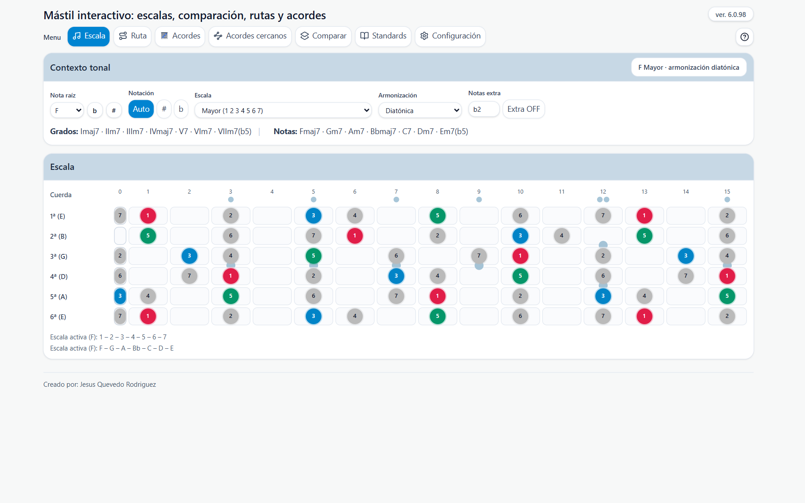
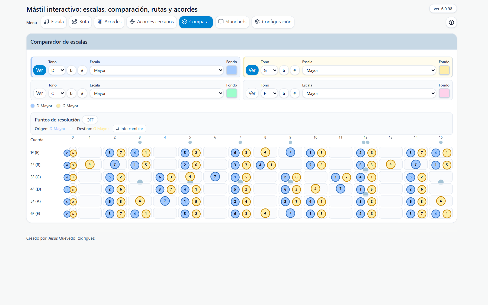
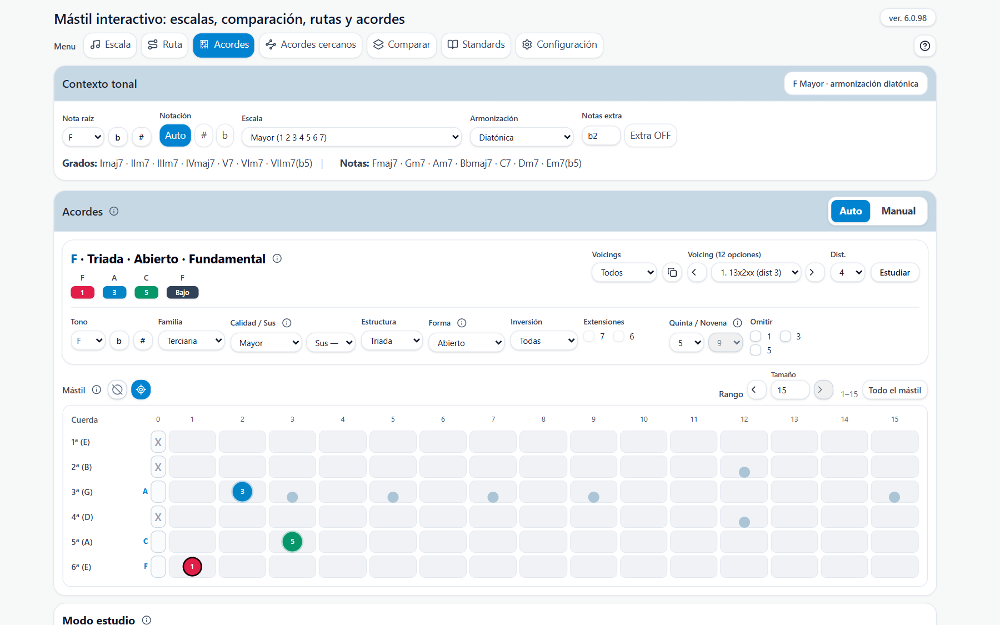
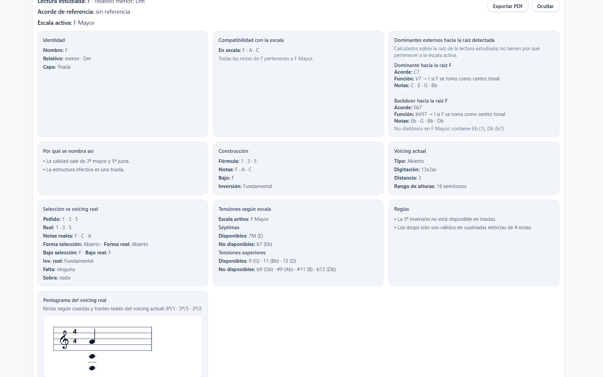
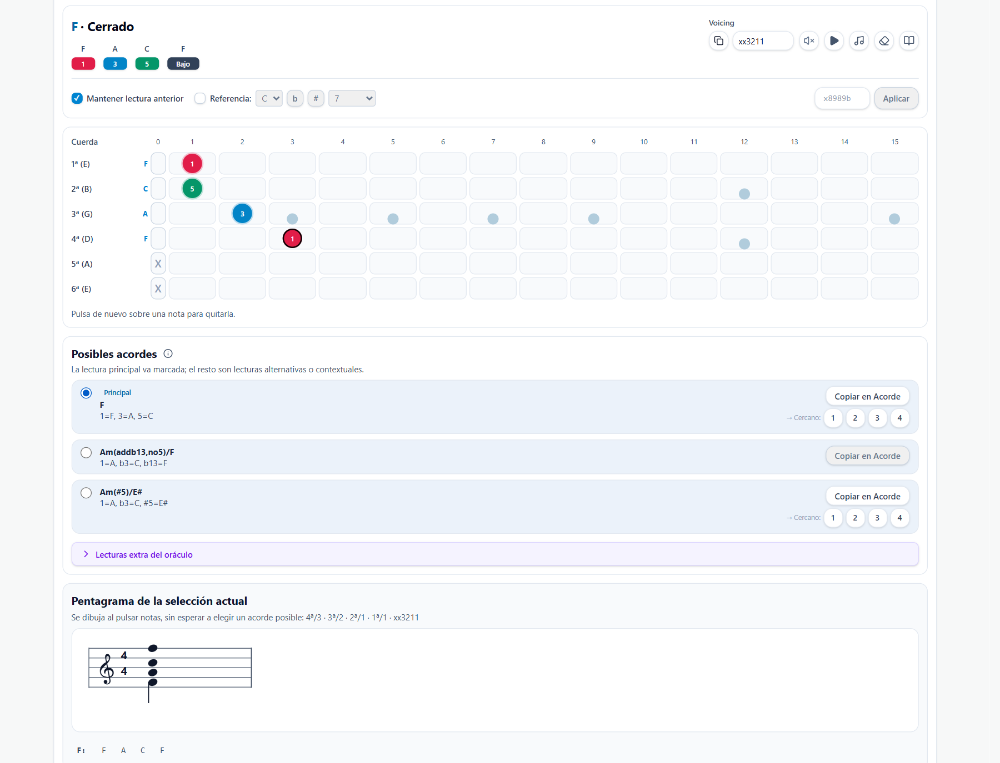
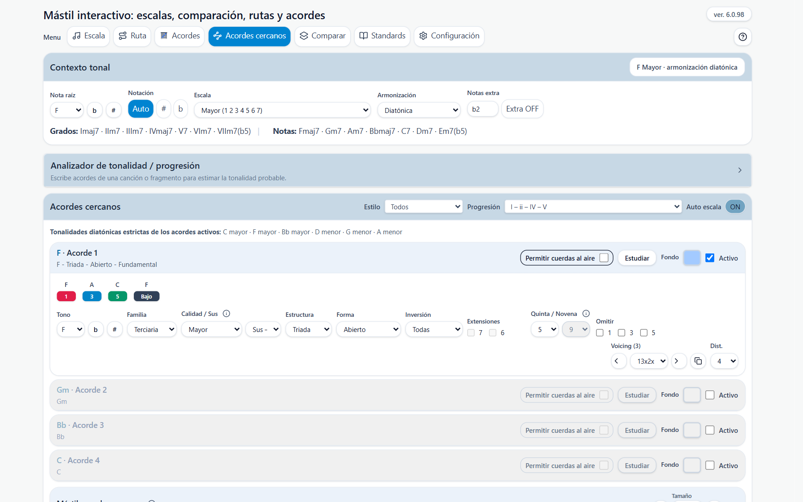
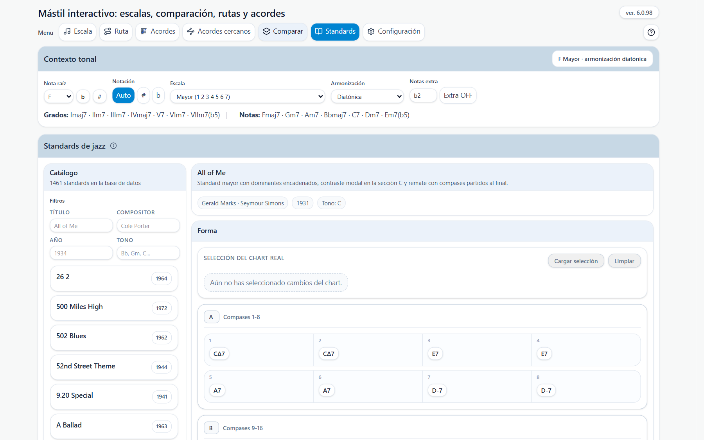

# Manual de uso

## Empezar

Mástil Escalas es una página para guitarristas. Muestra escalas, compara dos escalas, calcula rutas y construye acordes con digitaciones reales sobre el mástil. Funciona en el navegador, en escritorio y en móvil, y se puede instalar para usarla sin conexión.

Se organiza en secciones que eliges en la barra **Menu** (escritorio) o en la barra inferior (móvil):

| Sección | Para qué sirve |
| --- | --- |
| Escala | Ver en el mástil las notas de una escala y sus grados. |
| Ruta | Calcular un recorrido tocable entre una nota inicial y una final. |
| Acordes | Construir un acorde, recorrer sus voicings y estudiarlo. |
| Acordes cercanos | Comparar hasta cuatro acordes en una misma zona del mástil. |
| Comparar | Ver dos escalas a la vez sobre el mismo mástil. |
| Standards | Consultar el cifrado de standards y enviar acordes a Acordes cercanos. |
| Configuración | Guardar presets, exportar e importar la configuración. |

El interrogante de la cabecera abre una ayuda breve con el botón **Abrir el manual en PDF**, que muestra este documento. En móvil, el menú de tres rayas abre la configuración y la barra inferior cambia de sección.

*Figura 1. Sección Escala con la barra Menu y los controles de la escala activa.*

## Elegir la tonalidad y la escala

Estos ajustes se aplican a todas las secciones. Cámbialos primero y el resto se actualiza solo.

1. Elige la **Nota raíz**.
2. Elige la **Escala** (mayor, menor natural, pentatónica, modos…).
3. Decide qué ver en las celdas: **Notas**, **Intervalos** o ambos. Si empiezas, usa Notas; cuando ubiques bien el mástil, añade Intervalos.
4. Ajusta **Trastes** para ampliar o reducir el rango visible.

## Ver una escala en el mástil

La sección **Escala** resalta la raíz, la tercera, la quinta y el resto de notas de la escala activa.

- **Notas extra** añade tensiones u otras notas ajenas a la escala sin cambiarla.
- **Ver todo** muestra también las notas que no pertenecen a la escala.
- Al pasar el ratón por una celda vacía aparece el nombre de la nota de ese traste.

## Comparar dos escalas

La sección **Comparar** muestra hasta dos escalas a la vez, cada una con su color.

1. Activa una fila con **Ver** y elige su **Nota raíz** y su **Escala**.
2. Activa una segunda fila. Solo pueden estar visibles dos filas: al activar una tercera se desactiva la más antigua.
3. Lee el mástil: una nota exclusiva de una escala aparece en un círculo de su color; si las dos escalas comparten una nota, se ven dos círculos juntos en el mismo traste.
4. Con dos escalas activas, **Puntos de resolución** muestra dónde convergen o divergen las tensiones de ambas.

Sirve para comparar un modo con su escala paralela, ver el solapamiento entre tonalidades relativas o estudiar sustituciones.

*Figura 2. Sección Comparar: filas de escalas y mástil con las notas de cada una.*

## Calcular una ruta

La sección **Ruta** busca un recorrido, siguiendo la escala, entre una nota inicial y una final.

1. Indica **Inicio** y **Fin**. Puedes escribir una posición como `61` o elegirla con un clic en el mástil.
2. Ajusta **Máx. notas** por cuerda. Es un límite orientativo: la ruta intenta respetarlo, pero puede hacer un desplazamiento si mejora la digitación.
3. Revisa el recorrido resultante sobre el mástil.

La ruta prioriza avanzar con lógica de guitarrista: evita retrocesos absurdos de cuerda y favorece las trayectorias diagonales naturales.

*Figura 3. Sección Ruta con los controles Inicio, Fin y Máx. notas.*

## Construir un acorde

La sección **Acordes** parte de un acorde que defines y busca voicings reales en el mástil.

1. Elige el **Tono** y la **calidad** del acorde.
2. Elige la **estructura** (por ejemplo, tríada o cuatriada), la **forma** y la **inversión**, es decir, qué nota queda en el bajo.
3. Marca las **extensiones** que quieras (6, 7, 9, 11, 13). Las opciones que no son posibles con la estructura activa se desactivan y explican el motivo; en móvil, con el icono de información.
4. Recorre los voicings con las flechas o con el desplegable. **Dist.** limita la distancia entre la nota más grave y la más aguda.
5. Para copiar la digitación activa, pulsa el icono de copiar de la cabecera.

Otras opciones del constructor:

- Las listas **Quinta** y **Novena** permiten alterar la quinta (♭5, 5, ♯5) y la novena (♭9, 9, ♯9). Elegir ♯5 sobre un acorde mayor o dominante lo muestra como **Aumentada**.
- **sus2** y **sus4** sustituyen solo la tercera: conservan la quinta y la séptima, y al quitarlas vuelve el mismo acorde.
- **Cuerdas al aire** permite que los voicings incluyan cuerdas abiertas.
- El rango de trastes sobre el mástil limita los trastes donde se buscan y se muestran los voicings. **Todo el mástil** lo restablece. En móvil no se aplica.

*Figura 4. Sección Acordes: constructor, mástil con el voicing activo y selector de voicing.*

## Estudiar un acorde

Pulsa **Estudiar** junto al voicing para abrir el análisis del acorde, del voicing y de sus tensiones. El botón **Ver análisis** abre el mismo estudio y **Ocultar** lo cierra.

El análisis agrupa la información en bloques, entre ellos:

- **Identidad** y **Por qué se nombra así**: el nombre del acorde y la razón de esa lectura.
- **Compatibilidad con la escala**: si el acorde encaja en la escala activa.
- **Dominantes externos hacia la raíz detectada**.
- **Construcción** y **Voicing actual**: las notas y la digitación.
- **Tensiones según escala** y **Reglas**.
- **Pentagrama del voicing real**.

**Exportar PDF** genera un resumen imprimible del análisis visible.

*Figura 5. Sección Acordes con el estudio del acorde abierto.*

## Investigar notas en el mástil

El modo **Manual** invierte el flujo: marcas notas en el mástil y la aplicación propone qué acorde forman. Se activa con el selector **Auto** / **Manual** de la cabecera de Acordes.

1. Pulsa **Manual**. El cuadro de acorde queda bloqueado.
2. Pulsa las notas en el mástil. Solo puede haber una nota por cuerda: si pulsas otra en la misma cuerda, sustituye a la anterior.
3. Lee las lecturas posibles que propone la aplicación y copia la que prefieras a la sección de arriba para seguir editándola.
4. Pulsa **Auto** para volver al constructor.

Opciones útiles:

- Arriba a la derecha tienes los iconos de altavoz, **Play** y limpiar. El altavoz tachado indica que el sonido al pulsar está apagado. **Play** recorre la selección cuerda a cuerda, de 6ª a 1ª, y resalta cada nota.
- **Mantener lectura anterior** conserva la lectura funcional previa cuando el cambio de notas es pequeño. Si está apagado, siempre se elige el primer candidato del motor.
- **Priorizar acorde de referencia** reordena los candidatos favoreciendo la raíz y la calidad indicadas, sin eliminar ninguna lectura.

*Figura 6. Modo Manual: el cuadro de acorde queda bloqueado y el mástil admite la selección de notas.*

## Comparar acordes cercanos

La sección **Acordes cercanos** compara hasta cuatro acordes en una misma zona del mástil, para estudiar progresiones y conducción de voces.

1. Define los acordes de cada hueco, o activa **Auto escala** para que se generen según la raíz, la escala y la armonización activas. **Estilo** y **Progresión** controlan el tipo de armonía.
2. Con **Auto escala** desactivado, cada acorde queda en edición manual.
3. Fija el rango de trastes donde se buscan las digitaciones.
4. Revisa las digitaciones propuestas: se ordenan por cercanía al acorde de referencia.
5. Pulsa **Estudiar** en un hueco para analizar ese acorde.

Un flujo habitual para un ii-V-I en Do mayor: activa **Auto escala** con Do mayor y desplaza el rango de trastes hasta encontrar la posición con mejor conducción de voces.

*Figura 7. Sección Acordes cercanos con sus huecos de acorde y el mástil.*

## Trabajar con Standards

La sección **Standards** es un catálogo de más de 1400 temas.

1. Filtra el catálogo por título, autor, año o tonalidad y elige un tema.
2. En la ficha, lee los datos del tema y su **Forma**, el cifrado compás a compás.
3. Selecciona hasta cuatro acordes de la forma y envíalos a **Acordes cercanos** para estudiar sus voicings.

Los cifrados que la aplicación aún no sabe construir se conservan en pantalla, pero no se cargan: el hueco queda desactivado y se avisa del motivo.

*Figura 8. Catálogo de standards con sus filtros.*

*Figura 9. Ficha de un standard seleccionado, con su Forma.*

## Guardar y recuperar la configuración

La sección **Configuración** reúne los ajustes generales.

- **Presets rápidos** guardan y recuperan configuraciones habituales.
- **Exportar config** guarda toda la configuración en un archivo JSON.
- **Importar config** recupera una configuración anterior.
- **Restablecer** vuelve a los valores por defecto.

*Figura 10. Panel de Configuración.*

## Instalar y usar sin conexión

Puedes instalar la página como aplicación desde el navegador. En iPhone o iPad, usa «Añadir a pantalla de inicio» desde Safari.

1. Abre la página con conexión a Internet la primera vez.
2. Espera al aviso **Disponible sin conexión**. A partir de ahí funciona sin red, con todos los standards.
3. Cuando hay una versión nueva aparece **Actualizar ahora**.

Si cambia la versión de la aplicación, la configuración actual se restablece y los presets se conservan. Antes de actualizar, guarda un preset o exporta la configuración.

## Límites y consejos

- El límite de notas por cuerda en Ruta es orientativo, no estricto.
- Algunas combinaciones de estructura, inversión y extensiones no tienen voicing tocable; la aplicación lo indica en lugar de mostrar una digitación incorrecta.
- El rango de trastes de Acordes no se aplica en móvil.
- Para estudiar armonía, combina **Acordes**, **Estudiar** y **Acordes cercanos**.
- Empieza con una escala simple, por ejemplo mayor o pentatónica menor.
