# Manual de uso

## Primeros pasos

### Qué es Mástil Escalas

Mástil Escalas es una aplicación para guitarristas que dibuja sobre el mástil todo lo que se suele estudiar en papel: escalas y sus grados, la comparación entre dos escalas, recorridos melódicos entre dos notas y acordes con digitaciones reales. Además analiza los acordes que construyes o que marcas a mano, propone otras lecturas y sustituciones, y te permite trabajar la armonía de más de 1400 standards de jazz.

Funciona en el navegador, en ordenador y en móvil, y se puede instalar para usarla sin conexión (capítulo 12). No necesita cuenta ni guarda nada fuera de tu dispositivo.

Este manual está organizado por tareas. Si es la primera vez que abres la aplicación, lee este capítulo y el siguiente; después puedes ir directamente al capítulo de la tarea que te interese.

### La pantalla principal

En ordenador, la parte superior es siempre la misma: el título, la barra de secciones y, debajo, los paneles de la sección activa. Solo se ve una sección a la vez.

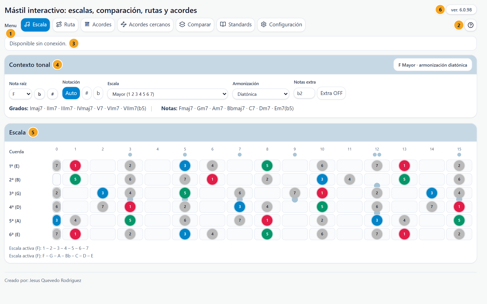

*Figura 1. Pantalla principal con la sección Escala activa. Los números identifican las zonas descritas en la tabla siguiente.*

| Nº | Zona | Para qué sirve |
| --- | --- | --- |
| 1 | Barra **Menu** | Cambia de sección: Escala, Ruta, Acordes, Acordes cercanos, Comparar, Standards y Configuración. El botón resaltado indica la sección activa. |
| 2 | Botón de ayuda (interrogante) | Abre la ayuda breve, con el botón **Abrir el manual en PDF** que muestra este documento (apartado 12.2). |
| 3 | Aviso de estado | Indica, por ejemplo, **Disponible sin conexión** o que hay una versión nueva con **Actualizar ahora**. |
| 4 | **Contexto tonal** | Nota raíz, escala y armonización con las que trabajan todas las secciones (capítulo 2). |
| 5 | Panel de la sección | En la figura, el mástil de la escala activa. Cada sección tiene sus propios paneles. |
| 6 | Versión | Número de versión de la aplicación instalada. Indícalo si comunicas un problema. |

Las secciones de la barra son:

| Sección | Para qué sirve | Capítulo |
| --- | --- | --- |
| Escala | Ver las notas de una escala y sus grados en todo el mástil. | 3 |
| Ruta | Calcular un recorrido tocable, nota a nota, entre dos posiciones. | 5 |
| Acordes | Construir un acorde, recorrer sus digitaciones, estudiarlo o identificar notas marcadas a mano. | 6, 7 y 8 |
| Acordes cercanos | Ver hasta cuatro acordes en la misma zona del mástil para trabajar progresiones. | 9 |
| Comparar | Superponer dos escalas y ver hacia dónde resuelven sus notas. | 4 |
| Standards | Consultar la forma de un standard y llevar sus acordes a Acordes cercanos. | 10 |
| Configuración | Vista del mástil, presets, copia de seguridad y colores. | 11 |

Muchos controles tienen un icono de información (una «i» dentro de un círculo). Al pasar el ratón por encima, o al pulsarlo en móvil, explica qué hace ese control o por qué una opción está desactivada.

### Cómo leer el mástil

Todos los mástiles de la aplicación siguen la misma convención: la guitarra se ve como si la tuvieras en las manos y miraras hacia abajo.

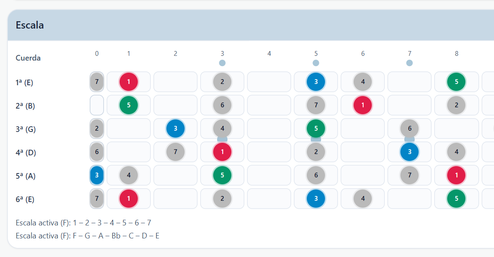

*Figura 2. Primeros trastes del mástil de Escala con Fa mayor. Cada círculo es una nota de la escala; el número indica su grado.*

- **Cuerdas.** Las filas son las cuerdas, numeradas como es habitual: la **1ª (E)** es la más aguda y está arriba; la **6ª (E)**, la más grave, abajo.
- **Trastes.** Las columnas son los trastes. El **0** es la cuerda al aire. Los puntos bajo los números de traste (3, 5, 7, 9 y doble en el 12) son las marcas de posición del diapasón.
- **Colores.** Cada nota de la escala se dibuja con el color de su función:

| Color por defecto | Significado |
| --- | --- |
| Rojo | Raíz (1). |
| Azul | Tercera, mayor o menor (3 o b3). |
| Verde | Quinta justa (5). |
| Gris | Resto de notas de la escala. |
| Naranja | Notas extra añadidas a la escala (apartado 2.5). |
| Violeta | Casillas que forman parte de una ruta (capítulo 5). |

Puedes cambiar estos colores en Configuración (apartado 11.4).

En varias partes de la aplicación aparecen dos notaciones compactas que conviene reconocer:

- **Posición de una nota**: cuerda seguida del traste. `61` es la 6ª cuerda en el traste 1 (un F); `113` es la 1ª cuerda en el traste 13. Se usa en Ruta.
- **Digitación de un acorde**: seis caracteres, uno por cuerda, de la 6ª a la 1ª. Un número es el traste que se pisa, `0` la cuerda al aire y `x` una cuerda que no suena. A partir del traste 10 se usan letras: `a` = 10, `b` = 11, `c` = 12, `d` = 13, `e` = 14 y `f` = 15. Así, `x7958x` es: 6ª muda, 5ª en el 7, 4ª en el 9, 3ª en el 5, 2ª en el 8 y 1ª muda.

### Un primer recorrido

Este recorrido de cinco minutos toca las funciones principales. No hace falta cambiar nada antes de empezar: la aplicación arranca en Fa mayor.

1. En **Contexto tonal**, elige `C` en **Nota raíz** y deja **Mayor** en **Escala**. El mástil de **Escala** muestra Do mayor.
2. Abre **Comparar**. Re mayor y Sol mayor aparecen superpuestas, cada una con su color; observa dónde se separan: Re mayor tiene C# y Sol mayor tiene C.
3. Abre **Acordes**. Elige **Tono** `C`, **Estructura** **Cuatriada** y recorre las digitaciones con las flechas del selector **Voicing**. Pulsa **Estudiar** para ver el análisis del acorde.
4. Abre **Acordes cercanos**. Con **Auto escala** activado verás los acordes I, ii, IV y V de la tonalidad; marca **Activo** en los huecos 2 a 4 y compara cómo quedan los cuatro en la misma zona del mástil.
5. Abre **Standards**, escribe `autumn` en **Título**, abre *Autumn Leaves*, selecciona sus cuatro primeros acordes y pulsa **Cargar selección**. Vuelve a **Acordes cercanos**: el ii-V-I del tema ya está allí.

## Contexto tonal: la base de todo

El panel **Contexto tonal** aparece encima de casi todas las secciones. Define la tonalidad con la que trabaja la aplicación: qué escala se dibuja en Escala y Ruta, qué acordes se generan en Acordes cercanos y con qué escala se comparan los acordes en el Modo estudio. Cambiarlo afecta a todas las secciones a la vez.

### Los controles del contexto tonal

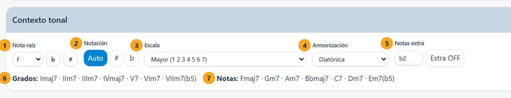

*Figura 3. Controles del panel Contexto tonal con Fa mayor y armonización diatónica.*

| Nº | Control | Qué hace |
| --- | --- | --- |
| 1 | **Nota raíz** | Elige la tónica. El desplegable da la letra y los botones **b** y **#** la bajan o suben un semitono; si ya está alterada, vuelven a la nota natural. |
| 2 | **Notación** | Decide cómo se escriben las notas alteradas: **Auto**, **#** (sostenidos) o **b** (bemoles). |
| 3 | **Escala** | La escala o modo activo. Entre paréntesis aparecen sus grados. |
| 4 | **Armonización** | **Diatónica** o **Funcional menor (V7)**. Cambia los acordes que se derivan de la escala. |
| 5 | **Notas extra** | Añade notas ajenas a la escala sin cambiarla. El botón **Extra OFF / Extra ON** las muestra u oculta. |
| 6 | **Grados** | Los acordes de cuatro notas de cada grado de la escala, en números romanos. |
| 7 | **Notas** | Los mismos acordes con su nombre real en la tonalidad activa. |

A la derecha de la cabecera del panel, un resumen recuerda la tonalidad activa, por ejemplo *F Mayor · armonización diatónica*. En el móvil, donde el panel aparece plegado, ese resumen es lo único que se ve hasta que lo despliegas.

### Nota raíz y notación

Elige la letra en el desplegable y altérala con **b** o **#**. Para Si bemol, por ejemplo, elige `B` y pulsa **b**.

**Notación** no cambia ninguna nota, solo su nombre. Con **Auto** la aplicación usa la armadura esperada de la tonalidad: en Fa mayor escribe Bb y no A#, y en Mi mayor escribe G# y no Ab. Fuerza **#** o **b** solo si quieres ver todas las notas con un mismo tipo de alteración.

### La escala

El desplegable **Escala** reúne más de treinta escalas, ordenadas alfabéticamente:

- **Mayor y modos griegos**: Jónica, Dórica, Frigia, Lidia, Mixolidia, Eólica y Locria.
- **Menores**: Menor natural, Menor armónica y Menor melódica (asc), con sus modos más usados, como Lidia dominante, Frigia dominante o Alterada (Superlocria).
- **Pentatónicas** mayor y menor, y sus variantes con *blue note*.
- **Bebop** (escalas de ocho notas): mayor, dominante, dórica, menor armónica, menor melódica, frigia dominante y locria.
- **Simétricas y otras**: Disminuida (H-W y W-H), Tonos enteros, Doble armónica, Húngara menor, Hirajoshi y Mayor armónica.
- **Personalizada**: al elegirla aparece el campo **Intervalos personalizados**, donde escribes la escala separando los elementos con espacios. Admite grados (`1 b3 4 5 b7`), nombres de nota (`F Ab C`) o semitonos desde la raíz (`s3`). La raíz se añade siempre.

### Armonización, grados y notas

Las líneas **Grados** y **Notas** muestran los acordes de cuatro notas que se forman sobre cada grado de la escala. En Fa mayor, por ejemplo, el I es Fmaj7, el ii Gm7 y el V C7.

**Armonización** solo cambia algo en las escalas menores:

- **Diatónica** construye cada acorde con las notas de la escala tal cual. En La menor natural el V es Em7.
- **Funcional menor (V7)** convierte el acorde del V grado en dominante, como hace la práctica tonal al subir la sensible. En La menor el V pasa a ser E7.

La armonización elegida es la que usa Acordes cercanos al generar progresiones (capítulo 9).

### Notas extra

**Notas extra** resalta en naranja notas que no pertenecen a la escala, sin cambiarla: una tensión que quieres localizar, una nota de paso cromática o la *blue note* de una pentatónica.

1. Escribe las notas en el campo, separadas por espacios. Admite el mismo formato que la escala Personalizada: grados (`b2`, `#4`), notas (`Gb`) o semitonos (`s1`).
2. Pulsa **Extra OFF** para que pase a **Extra ON**.
3. Debajo del mástil aparecen dos líneas *Extra* con los grados y las notas añadidas.

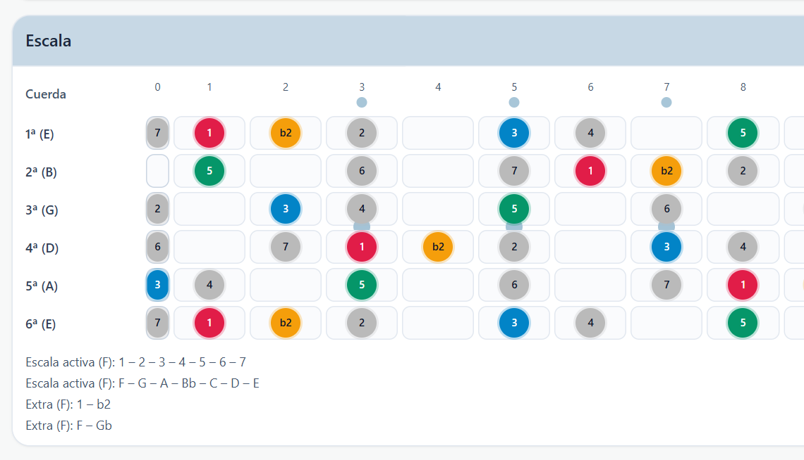

*Figura 4. Fa mayor con la nota extra b2 (Gb) activada: aparece en naranja en todas las cuerdas.*

### Casita blues

Cuando la escala activa es una pentatónica (mayor o menor, con o sin *blue note*), aparece en el contexto tonal el control **Casita blues**. Resalta sobre el mástil de Escala las dos «casitas» clásicas del blues, dos pequeñas zonas de las tres cuerdas agudas que se colocan a partir de cada raíz de la 2ª cuerda. Sus notas llevan un contorno de color:

- **B.B. King**: la raíz de la 2ª cuerda y los dos trastes siguientes hacia el puente. En una tonalidad menor reúne la raíz, la 2, la 4, la #4, la 5 y la 6.
- **Albert**: la raíz de la 2ª cuerda y los dos trastes anteriores hacia el clavijero, con la b3, la 4, la 5, la b7 y la raíz.
- **Ambas**: las dos a la vez.

Marca **Casita**, elige cuál en el desplegable y, si quieres, cambia el color de cada una con las muestras **BB** y **A**.

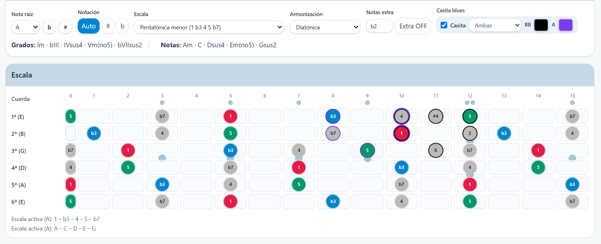

*Figura 5. La pentatónica menor con las dos casitas activadas. Las notas de cada casita llevan un contorno de color, y aparecen notas de apoyo fuera de la escala (2, #4, 6) que forman parte de esas frases.*

## Ver y estudiar una escala

### La sección Escala

La sección **Escala** dibuja la escala del contexto tonal en todo el rango de trastes visible. Debajo del mástil, dos líneas resumen la escala activa: sus grados (*1 – 2 – 3 – 4 – 5 – 6 – 7*) y sus notas (*F – G – A – Bb – C – D – E*).

Al pasar el ratón por una casilla vacía aparece el nombre de la nota de ese traste, aunque no pertenezca a la escala. Es una forma rápida de orientarte sin cambiar la vista.

### Notas, intervalos o ambos

El texto que aparece dentro de cada círculo se elige en Configuración, en **Vista** (apartado 11.1). **Notas** e **Intervalos** son dos interruptores independientes:

- Solo **Intervalos** (la opción por defecto): cada círculo muestra su grado (1, 3, b7…). Es la vista más útil para entender la función de cada nota y trasladar lo aprendido a otras tonalidades.
- Solo **Notas**: cada círculo muestra el nombre de la nota (F, Bb…).
- Los dos activos: cada círculo muestra grado y nota, por ejemplo `1-F` o `4-Bb`.

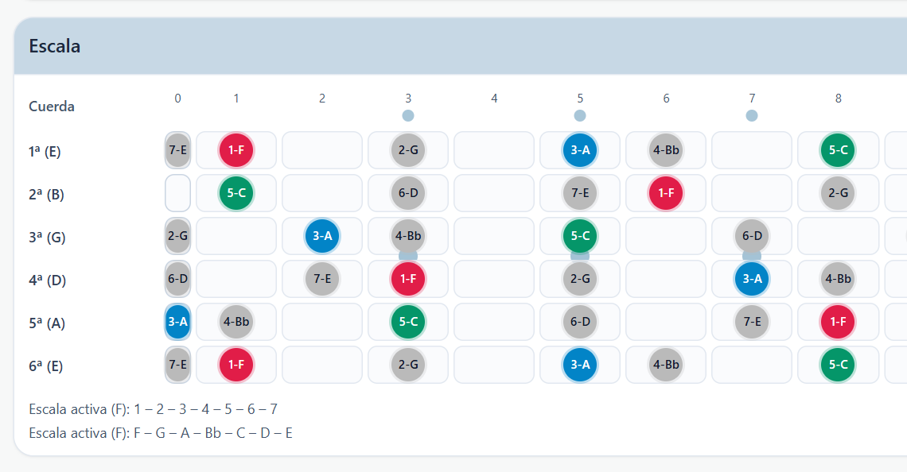

*Figura 6. Vista con Notas e Intervalos activos a la vez: cada círculo muestra el grado y el nombre de la nota.*

> **Consejo.** Si empiezas, activa solo Notas hasta que localices bien las notas en el mástil. Después cambia a Intervalos: verás que los patrones de la escala son los mismos en cualquier tonalidad.

### Ver todas las notas

**Ver todo**, en Configuración (**Fondo**), muestra en gris claro el nombre de todas las notas que no pertenecen a la escala. Sirve para ver de un vistazo qué hay entre las notas de la escala y localizar cromatismos.

*Figura 7. Vista de Notas con Ver todo: las notas de la escala en círculos y el resto de notas del mástil escritas en gris.*

### Rango de trastes

El control **Trastes** de Configuración fija hasta qué traste se dibujan los mástiles: 0–12, 0–15 (por defecto), 0–18, 0–21 o 0–24. Un rango corto hace las casillas más anchas y más fáciles de leer; uno largo permite trabajar las posiciones agudas.

### Ideas para estudiar una escala

- **Localiza las raíces primero.** Con la vista de Intervalos, busca los círculos rojos en la 6ª y la 5ª cuerda: son los puntos de partida de las digitaciones más habituales.
- **Trabaja por zonas.** Elige un rango corto y recorre la escala entre dos raíces sin salir de cuatro o cinco trastes.
- **Compara modos.** Cambia de Jónica a Dórica o a Mixolidia sin mover la raíz y observa qué círculos cambian: son las notas características de cada modo.
- **Combina con Ruta.** Cuando conozcas una zona, calcula una ruta (capítulo 5) para enlazarla con la siguiente.

## Comparar dos escalas

La sección **Comparar** superpone dos escalas en el mismo mástil, cada una con su color. Es útil para ver qué notas cambian entre dos tonalidades, comparar un modo con su escala paralela o preparar el cambio de escala sobre un cambio de acorde.

### Las filas del comparador

El comparador tiene cuatro filas configurables, pero solo dos pueden verse a la vez.

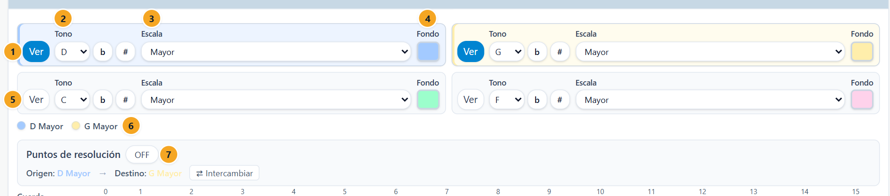

*Figura 8. Las cuatro filas del comparador. Re mayor (azul) y Sol mayor (amarillo) están activas.*

| Nº | Control | Qué hace |
| --- | --- | --- |
| 1 | **Ver** | Activa o desactiva la fila. Activa aparece resaltada. |
| 2 | **Tono** | Tónica de la escala de esa fila, con los botones **b** y **#**. |
| 3 | **Escala** | Escala de la fila. |
| 4 | **Fondo** | Color de esa escala en el mástil y en la leyenda. |
| 5 | **Ver** (fila inactiva) | Al activar una tercera fila se desactiva automáticamente la que lleva más tiempo activa. |
| 6 | Leyenda | Recuerda el color de cada escala visible. |
| 7 | **Puntos de resolución** | Interruptor que dibuja las flechas de resolución entre las dos escalas (apartado 4.3). |

### Leer el mástil comparado

- Una nota que solo pertenece a una escala aparece en un círculo del color de esa escala.
- Una nota que comparten las dos escalas aparece como **dos círculos juntos** en el mismo traste, uno de cada color.
- Dentro de cada círculo se ve el grado que esa nota tiene en su escala (o la nota, según la Vista de Configuración). Así, en un mismo traste puedes leer que una nota es la 5 de una escala y la 1 de la otra.

Re mayor y Sol mayor, por ejemplo, comparten seis notas y solo se diferencian en una: C# en Re mayor y C en Sol mayor.

### Puntos de resolución

Con dos escalas visibles, activa **Puntos de resolución**. La aplicación dibuja flechas desde notas de la escala **origen** hacia las notas más importantes de la escala **destino** que están a uno o dos trastes en la misma cuerda. Las notas objetivo son la 3ª y la 7ª (mayores o menores), la raíz y la 5ª, y la nota característica cuando la escala destino es un modo: #4 en Lidia, b7 en Mixolidia, 6 en Dórica y b2 en Frigia.

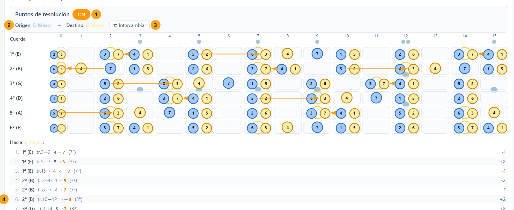

*Figura 9. Puntos de resolución de Re mayor (origen) hacia Sol mayor (destino), con las flechas sobre el mástil y las primeras conexiones de la lista.*

| Nº | Control | Qué hace |
| --- | --- | --- |
| 1 | **Puntos de resolución** | Activa o desactiva las flechas. Solo funciona con dos escalas visibles. |
| 2 | **Origen** y **Destino** | Indican de qué escala sale cada flecha y a cuál llega. |
| 3 | **Intercambiar** | Invierte el sentido: la escala destino pasa a ser el origen. |
| 4 | Lista **Hacia…** | Las conexiones más útiles, hasta doce, ordenadas por importancia. |

Cada línea de la lista se lee así: *1ª (E) tr.3→2 4→7 (7ª) −1* significa que en la 1ª cuerda, del traste 3 al 2, la 4 de la escala origen (G en Re mayor) baja un traste hasta la 7 de la escala destino (F# en Sol mayor). El número final es el desplazamiento en trastes: negativo hacia el clavijero y positivo hacia el puente.

> **Consejo.** Usa las flechas para preparar los cambios de acorde: tocar en el último tiempo una nota que resuelve por semitono en la 3ª o la 7ª del acorde siguiente hace que la frase «aterrice» con claridad.

## Calcular una ruta

La sección **Ruta** busca un recorrido por las notas de la escala activa entre una posición inicial y una final, con una digitación razonable para la mano izquierda. Sirve para enlazar posiciones, practicar escalas en diagonal o encontrar un camino entre dos notas concretas.

### Los controles de Ruta

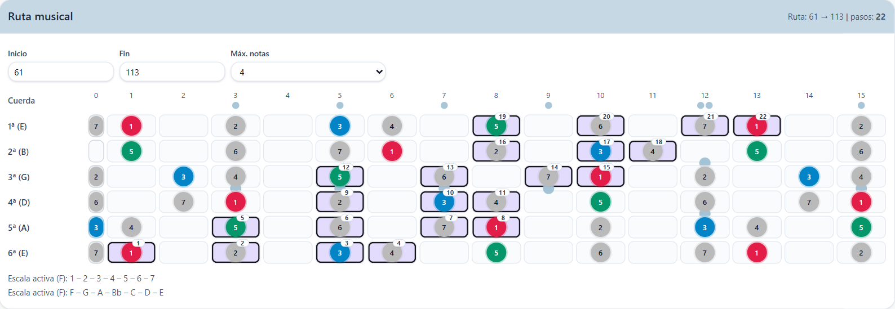

*Figura 10. Ruta de 61 a 113 en Fa mayor: 22 pasos numerados sobre el mástil.*

| Nº | Control | Qué hace |
| --- | --- | --- |
| 1 | **Inicio** | Posición de la primera nota, en formato cuerda + traste (`61` = 6ª cuerda, traste 1). |
| 2 | **Fin** | Posición de la última nota, en el mismo formato. |
| 3 | **Máx. notas** | Número de notas por cuerda que la ruta intenta no superar (de 1 a 5; por defecto, 4). |
| 4 | Resumen | Inicio, fin y número de pasos de la ruta calculada. |

### Indicar el inicio y el fin

Hay dos formas de indicar las posiciones:

- **Escribiéndolas** en **Inicio** y **Fin**: primero el número de cuerda (1 a 6) y después el traste. `52` es la 5ª cuerda en el traste 2; `110` es la 1ª cuerda en el traste 10.
- **Pulsando en el mástil**: el primer clic fija el inicio y el siguiente el fin, alternando. Solo se pueden pulsar notas de la escala activa.

La ruta se recalcula en cuanto cambias cualquiera de los dos.

### Leer el recorrido

Las casillas de la ruta se dibujan con fondo violeta y un número pequeño encima que indica el orden: 1 es la nota inicial y el último número, la final. Sigue los números para tocar la ruta. Las notas de la escala que no forman parte del recorrido se mantienen visibles para que veas la ruta dentro de su contexto.

### El pentagrama de la ruta

Debajo del mástil, el **Pentagrama 4/4** escribe la ruta en notación musical, con la armadura de la tonalidad y el nombre de cada nota. Ayuda a comprobar la dirección de la melodía y a leerla como un ejercicio escrito.

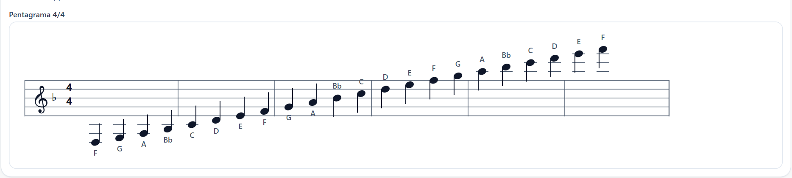

*Figura 11. La misma ruta escrita en el pentagrama, con la armadura de Fa mayor (un bemol).*

### Cómo decide la ruta

La ruta intenta avanzar como lo haría un guitarrista: evita retrocesos absurdos de cuerda y favorece las trayectorias diagonales naturales. **Máx. notas** es un límite orientativo: si respetarlo obliga a una digitación peor, la ruta puede colocar alguna nota más en una cuerda o hacer un pequeño desplazamiento.

El botón **Debug** de Configuración muestra detalles técnicos del cálculo de la ruta. No es necesario para el uso normal.

## Construir acordes

La sección **Acordes** construye un acorde a partir de sus características (tono, calidad, estructura, forma, inversión y extensiones) y busca todas las digitaciones reales que lo cumplen. Tiene dos modos, elegidos con el selector **Auto / Manual** de su cabecera: en **Auto** defines el acorde y la aplicación busca las digitaciones; en **Manual** marcas tú las notas y la aplicación dice qué acorde forman (capítulo 8).

### El constructor

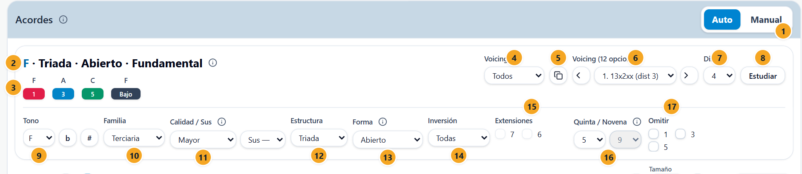

*Figura 12. Constructor de acordes en modo Auto, con la tríada de Fa mayor que aparece al abrir la aplicación.*

| Nº | Control | Qué hace |
| --- | --- | --- |
| 1 | **Auto / Manual** | Cambia entre construir el acorde y marcar notas en el mástil (capítulo 8). |
| 2 | Título | Nombre del acorde y resumen de la estructura, la forma y la inversión elegidas. |
| 3 | Notas del acorde | Cada nota con su grado en color; la etiqueta **Bajo** indica la nota más grave del voicing activo. |
| 4 | **Voicings** | Filtra la lista de digitaciones: **Todos**, **Habituales** o **Esenciales** (apartado 6.3). |
| 5 | Copiar | Copia al portapapeles la digitación activa, por ejemplo `13x2xx`. |
| 6 | **Voicing** | Lista de digitaciones encontradas, con flechas para pasar a la anterior o la siguiente. |
| 7 | **Dist.** | Número máximo de trastes que puede abarcar una digitación. |
| 8 | **Estudiar** | Abre el Modo estudio del acorde (capítulo 7). |
| 9 | **Tono** | Nota base del acorde, con **b** y **#**. |
| 10 | **Familia** | **Terciaria** (acordes por terceras), **Cuartal** o **Notas guía** (apartado 6.6). |
| 11 | **Calidad / Sus** | Calidad del acorde y, en el segundo desplegable, una suspensión. |
| 12 | **Estructura** | **Triada**, **Cuatriada** o **Acorde** (con extensiones superiores). |
| 13 | **Forma** | Disposición de las voces: cerrada, abierta o drop. |
| 14 | **Inversión** | Qué nota del acorde queda en el bajo. |
| 15 | **Extensiones** | Casillas 7, 6, 9, 11 y 13, según la estructura. |
| 16 | **Quinta / Novena** | Alteraciones de la quinta (♭5, 5, ♯5) y de la novena (♭9, 9, ♯9). |
| 17 | **Omitir** | Quita la raíz, la tercera o la quinta del acorde. |

### Qué significa cada control

**Tono.** Es la raíz del acorde y es independiente de la nota raíz del contexto tonal: puedes construir un G7 mientras trabajas en Do mayor.

**Calidad / Sus.** Las calidades disponibles son **Mayor**, **Dominante (7)**, **Aumentada**, **Menor**, **m(maj7)**, **Disminuido** y **m7(b5)**. **Aumentada** combina tercera mayor y ♯5 conservando el tipo de séptima, de modo que da Caug, C7(♯5) o Cmaj7(♯5). El segundo desplegable añade **sus2** o **sus4**, que sustituyen solo la tercera por la segunda o la cuarta: la quinta y la séptima se conservan, y al quitar la suspensión vuelve el mismo acorde.

**Estructura.** **Triada** usa tres notas (1, 3, 5); **Cuatriada**, cuatro (añade la séptima o la sexta); **Acorde** permite además las extensiones 9, 11 y 13.

**Forma.** Decide cómo se reparten las voces:

- **Cerrado**: las notas apiladas en el orden más compacto posible.
- **Abierto**: una voz se reparte a otra octava para dar más amplitud.
- **Drop 2**: parte del acorde cerrado y baja una octava la segunda voz contando desde arriba. Es la forma drop más usada: las cuatro notas quedan en cuatro cuerdas seguidas.
- **Drop 3**: baja una octava la tercera voz desde arriba. Deja una cuerda muda justo después del bajo.
- **Drop 2+4**: baja a la vez la segunda y la cuarta voz. La cuerda muda queda en medio del voicing.
- **Set**: el grupo de cuerdas en que se coloca la forma drop, del más agudo (**Set 1**) al más grave. Drop 2 cabe en tres sets (cuerdas 4ª–1ª, 5ª–2ª y 6ª–3ª); Drop 3 y Drop 2+4, por su cuerda muda, caben en dos.

Las formas drop solo están disponibles en cuatriadas de exactamente cuatro notas.

**Inversión.** **Fundamental** pone la raíz en el bajo; **1ª inversión**, la tercera; **2ª inversión**, la quinta; **3ª inversión**, la séptima (solo en cuatriadas). **Todas** muestra las digitaciones de cualquier inversión.

**Extensiones.** Añaden la 7, la 6, la 9, la 11 o la 13. Las que no tienen sentido con la estructura activa no aparecen o están desactivadas. Al elegir **Cuatriada** se marca automáticamente la 7.

**Quinta / Novena.** ♭5 o ♯5 sustituyen a la quinta; si la combinación tiene nombre propio, la calidad se ajusta (un m7 con ♭5 pasa a ser m7(♭5), y ♯5 sobre un acorde mayor o dominante lo muestra como **Aumentada**). La novena solo puede alterarse cuando el acorde la incluye; en una tríada está desactivada.

**Omitir.** Quita una nota del acorde para aligerar el voicing: la raíz (habitual cuando la toca el bajista), la quinta (la menos característica) o incluso la tercera. El nombre del acorde lo indica, por ejemplo con *no5*.

Cuando una opción no es posible con el resto de la configuración, aparece desactivada y su icono de información explica el motivo. En móvil, pulsa el icono para leerlo.

### Elegir la digitación

El desplegable **Voicing** enumera las digitaciones encontradas con el formato *número. digitación (dist N)*; por ejemplo, *1. 13x2xx (dist 3)*. Las flechas a su lado pasan a la anterior o a la siguiente, y el mástil se actualiza al momento.

- **Dist.** limita cuántos trastes puede abarcar la digitación, **contando el primero y el último**. `13x2xx` usa los trastes 1, 2 y 3: abarca 3 trastes. Las cuerdas al aire no cuentan. Elige 4, 5 o 6.
- **Voicings** filtra la lista. **Todos** muestra todo lo que se ha encontrado, incluidas variantes generadas automáticamente. **Habituales** se queda con las formas de catálogo que se tocan de verdad, sin cuerdas muertas en medio. **Esenciales** reduce aún más la lista: una forma por zona del mástil, dentro de la primera octava.
- El botón de copiar pone en el portapapeles la digitación activa, lista para pegarla en tus notas.

### El mástil de Acordes

Debajo del constructor, el mástil muestra la digitación activa. A la izquierda de cada cuerda aparece el nombre de la nota que suena en ella.

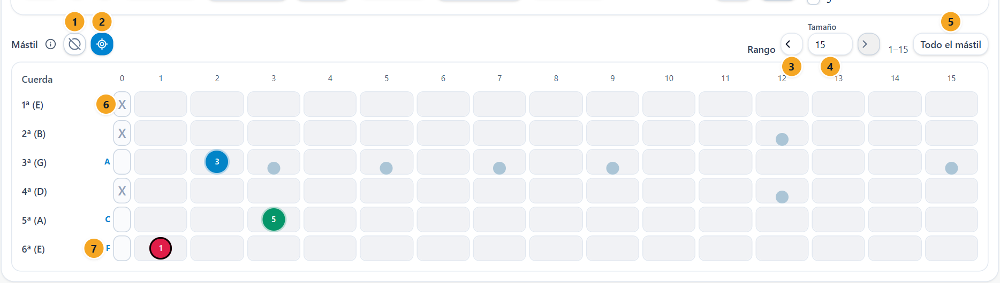

*Figura 13. Mástil de Acordes con la digitación 13x2xx de Fa mayor y sus controles.*

| Nº | Control | Qué hace |
| --- | --- | --- |
| 1 | **Permitir cuerdas al aire** (círculo) | Deja que las digitaciones usen cuerdas al aire. Tachado significa desactivado. |
| 2 | **Mantener zona anterior** (diana) | Al cambiar de acorde, elige la digitación más cercana a la anterior. Tachada significa desactivada. |
| 3 | **Rango** | Las flechas desplazan un traste el rango donde se buscan las digitaciones. |
| 4 | **Tamaño** | Número de trastes que abarca el rango. |
| 5 | **Todo el mástil** | Restablece el rango desde el traste 1 hasta el último. |
| 6 | Cuerda muda | Una **X** junto al traste 0 indica que esa cuerda no se toca. |
| 7 | Nota de la cuerda | Nombre de la nota que suena en cada cuerda del voicing. |

El rango limita la búsqueda: solo se ofrecen digitaciones cuyas notas pisadas caen entre los trastes indicados. Las cuerdas al aire, si están permitidas, se admiten aunque el traste 0 quede fuera del rango. El rango no se aplica en móvil, donde se muestran las posiciones de todo el mástil.

> **Consejo.** Activa **Mantener zona anterior** cuando practiques una progresión acorde a acorde: la mano se queda en la misma zona y verás la conducción de voces sin saltos.

### Ejemplo: Cmaj7 en Drop 2 con la 3ª en el bajo

Este ejemplo construye un voicing muy usado en jazz y muestra qué hacer cuando la aplicación no encuentra digitaciones.

1. En **Contexto tonal**, pon la **Nota raíz** en `C` para trabajar en Do mayor.
2. En el constructor, elige **Tono** `C`, **Calidad** **Mayor** y **Estructura** **Cuatriada**. La casilla 7 se marca sola y el acorde pasa a ser Cmaj7.
3. Elige **Forma** **Drop 2 Set 2** (cuerdas 5ª a 2ª) e **Inversión** **1ª inversión** (E en el bajo).
4. Aparece el aviso «No he encontrado voicings para este acorde con los filtros actuales».

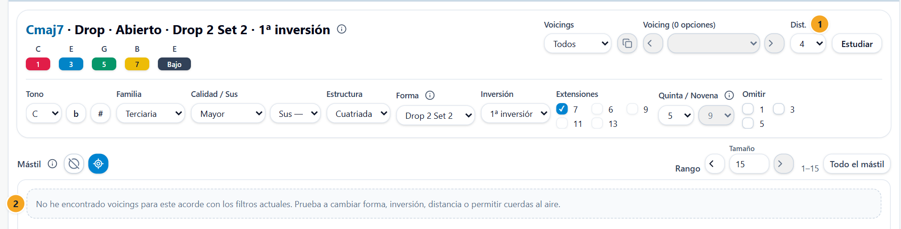

*Figura 14. Con Dist. 4 no hay ninguna digitación: el aviso propone cambiar forma, inversión, distancia o cuerdas al aire.*

El motivo es la distancia. Para tener E en el bajo en Drop 2, se parte del acorde cerrado en 3ª inversión (B C E G) y se baja una octava la segunda voz desde arriba, la E: queda E B C G. En el set 2 eso es `x7958x`, que va del traste 5 al 9 y abarca cinco trastes.

5. Cambia **Dist.** a `5`. Aparece la digitación `x7958x`.

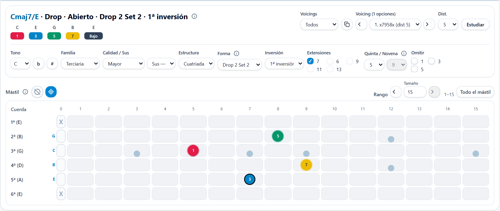

*Figura 15. Cmaj7/E en Drop 2 Set 2: E en la 5ª cuerda, B en la 4ª, C en la 3ª y G en la 2ª.*

### Familias Cuartal y Notas guía

Además de los acordes por terceras, **Familia** ofrece dos tipos de voicing con controles propios.

**Cuartal** construye acordes apilando cuartas, un sonido abierto típico del jazz modal.

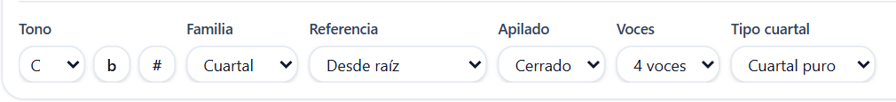

*Figura 16. Controles de la familia Cuartal.*

- **Referencia**: **Desde raíz** apila las cuartas a partir del tono elegido; **Diatónico a escala** toma el tono como centro tonal y genera acordes cuartales sobre los grados de la escala que elijas, así que el resultado puede no empezar en la raíz.
- **Apilado**: **Cerrado** mantiene las cuartas seguidas; **Abierto** desplaza alguna voz una octava.
- **Voces**: número de notas del acorde.
- **Tipo cuartal**: **Cuartal puro** usa solo cuartas justas; **Mixto** incluye al menos una cuarta aumentada.

**Notas guía** reduce el acorde a lo imprescindible: la raíz con la 3ª y la 7ª, las notas que definen su calidad. Son los clásicos *shell voicings* de tres notas para acompañar.

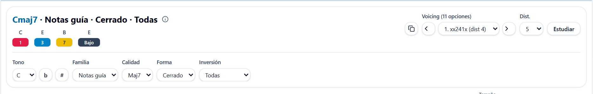

*Figura 17. Cmaj7 en Notas guía: C, E y B. Los controles se reducen a Calidad, Forma e Inversión.*

## Estudiar un acorde (Modo estudio)

El Modo estudio analiza el acorde activo, el voicing que estás viendo y su relación con la escala del contexto tonal. Está disponible en Acordes, en Acordes cercanos (botón **Estudiar** de cada hueco) y en el modo Manual.

### Abrir y cerrar el estudio

- **Estudiar**, junto al selector de voicing, abre el análisis del acorde activo.
- El panel **Modo estudio**, debajo del mástil, resume siempre la lectura estudiada, el acorde de referencia y la escala activa. Su botón **Ver análisis** abre el mismo detalle y **Ocultar** lo cierra.
- **Exportar PDF** abre una ventana con un resumen imprimible del análisis visible; desde ella puedes imprimirlo o guardarlo como PDF. Si no se abre, comprueba que el navegador no bloquea las ventanas emergentes.

### Los bloques del análisis

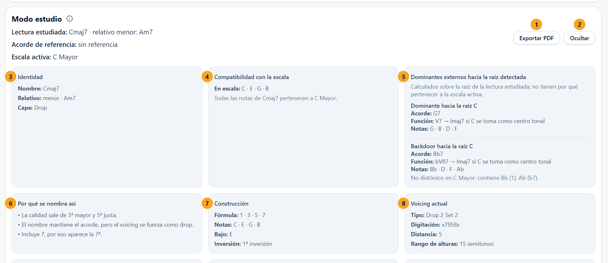

*Figura 18. Modo estudio de Cmaj7/E en Drop 2 Set 2, con Do mayor como escala activa.*

| Nº | Bloque | Qué contiene |
| --- | --- | --- |
| 1 | **Exportar PDF** | Resumen imprimible del análisis. |
| 2 | **Ocultar** | Cierra el detalle del estudio. |
| 3 | **Identidad** | Nombre del acorde, su relativo y la capa (tríada, cuatriada, drop…). |
| 4 | **Compatibilidad con la escala** | Qué notas del acorde están en la escala activa y, si alguna no lo está, qué acorde diatónico sería el esperado. |
| 5 | **Dominantes externos** | El dominante (V7) y el *backdoor* (bVII7) que resuelven en la raíz del acorde, con sus notas y si son diatónicos en la escala activa. |
| 6 | **Por qué se nombra así** | La razón de la lectura: qué intervalos definen la calidad y qué extensiones incluye. |
| 7 | **Construcción** | Fórmula, notas, bajo e inversión del acorde pedido. |
| 8 | **Voicing actual** | Tipo, digitación, distancia y rango de alturas del voicing que ves en el mástil. |

### Voicing real, tensiones y reglas

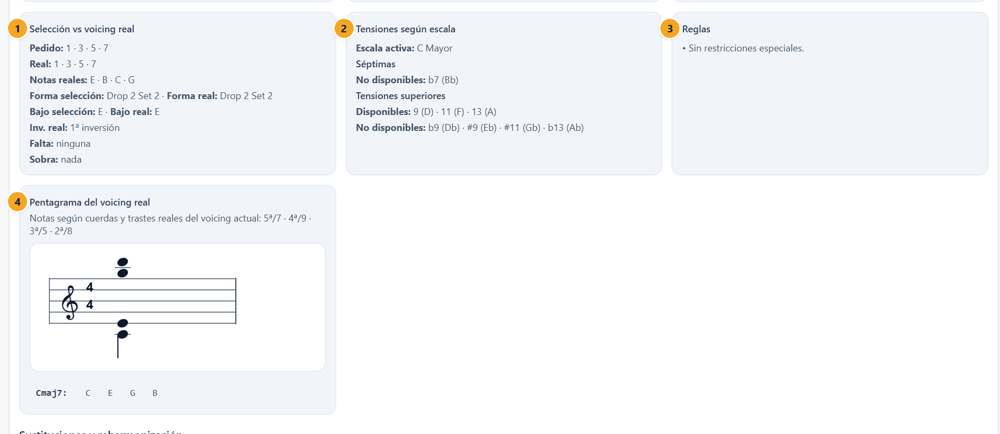

*Figura 19. Comparación entre lo pedido y lo tocado, tensiones disponibles en Do mayor, reglas y pentagrama del voicing.*

| Nº | Bloque | Qué contiene |
| --- | --- | --- |
| 1 | **Selección vs voicing real** | Compara la fórmula, la forma y el bajo que pediste con lo que suena en la digitación, y señala si **falta** o **sobra** alguna nota. |
| 2 | **Tensiones según escala** | Qué séptimas y tensiones (9, 11, 13 y sus alteraciones) pertenecen a la escala activa (**Disponibles**) y cuáles no (**No disponibles**). |
| 3 | **Reglas** | Restricciones que afectan a la combinación elegida, por ejemplo que la 3ª inversión no existe en tríadas o que los drops exigen cuatro notas. |
| 4 | **Pentagrama del voicing real** | Las notas del voicing escritas en el pentagrama, a partir de las cuerdas y trastes reales. |

> **Atención.** «Disponible» significa que la tensión pertenece a la escala, no que funcione en cualquier voicing. Sobre Cmaj7 en Do mayor la 11 (F) aparece como disponible, pero contra la 3ª (E) forma una novena menor y suele tratarse como nota a evitar.

### Sustituciones y rearmonización

Al final del estudio, **Sustituciones y reharmonización** explica qué acordes pueden sustituir al estudiado y por qué. Se organiza en cinco pestañas: **Diatónicas**, **Cromáticas y jazz**, **Por préstamo**, **Estructura y color** y **Avanzadas y extras**.

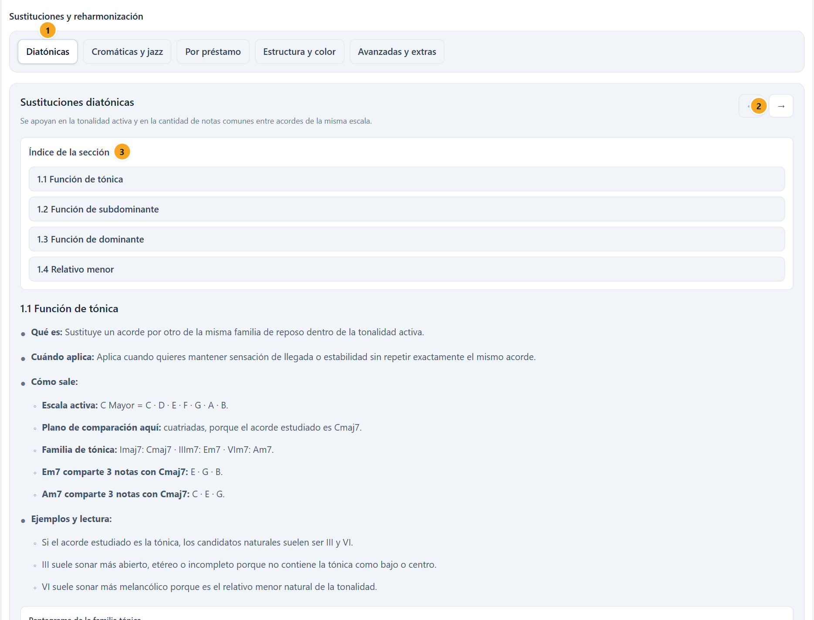

*Figura 20. Pestaña Diatónicas de las sustituciones de Cmaj7 en Do mayor.*

| Nº | Elemento | Qué hace |
| --- | --- | --- |
| 1 | Pestañas | Cambian de familia de sustituciones. |
| 2 | Flechas | Pasan a la pestaña anterior o siguiente. |
| 3 | **Índice de la sección** | Enlaces a cada sustitución de la pestaña. |

Cada sustitución sigue el mismo esquema: **Qué es**, **Cuándo aplica**, **Cómo sale** (los cálculos concretos con la escala activa y las notas comunes) y **Ejemplos y lectura**, seguidos de un pentagrama con los acordes implicados. En la figura, por ejemplo, Am7 comparte tres notas con Cmaj7 y por eso es un sustituto natural de la tónica.

## Investigar notas en el mástil (modo Manual)

El modo **Manual** invierte el flujo del constructor: marcas notas en el mástil, o escribes una digitación, y la aplicación propone qué acordes pueden formar. Es la forma de averiguar el nombre de un acorde que has encontrado tocando o que aparece en una partitura.

### Marcar notas

Pulsa **Manual** en la cabecera de Acordes. El constructor queda bloqueado y el mástil admite clics.

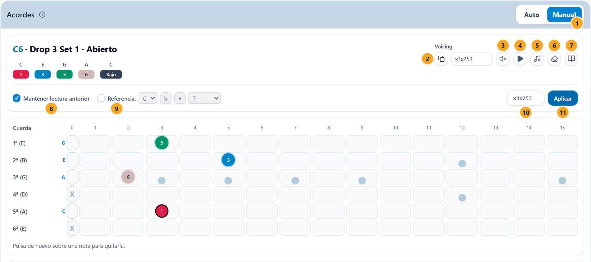

*Figura 21. Modo Manual con la digitación x3x253 (C, A, E, G). La aplicación la clasifica como C6 en Drop 3 Set 1.*

| Nº | Control | Qué hace |
| --- | --- | --- |
| 1 | **Auto / Manual** | Vuelve al constructor con **Auto**. |
| 2 | Copiar | Copia la digitación marcada; a su derecha se ve escrita. |
| 3 | Altavoz | Activa o desactiva el sonido de cada nota al pulsarla. Tachado significa apagado. |
| 4 | Reproducir | Toca la selección cuerda a cuerda, de 6ª a 1ª, resaltando cada nota. |
| 5 | Nota musical | Toca todo el voicing a la vez. |
| 6 | Limpiar | Borra todas las notas marcadas. |
| 7 | Libro | Abre el Modo estudio de la lectura activa. |
| 8 | **Mantener lectura anterior** | Conserva la lectura previa cuando el cambio de notas es pequeño (apartado 8.4). |
| 9 | **Referencia** | Indica un acorde de contexto para ordenar las lecturas (apartado 8.4). |
| 10 | Campo de digitación | Permite escribir la digitación en lugar de pulsar el mástil. |
| 11 | **Aplicar** | Marca en el mástil la digitación escrita. |

Al marcar notas:

- Solo puede haber **una nota por cuerda**. Si pulsas otra en la misma cuerda, sustituye a la anterior.
- Pulsa de nuevo una nota para quitarla.
- A la izquierda de cada cuerda se ve el nombre de la nota marcada y, sobre el mástil, su grado respecto a la lectura activa.

### Escribir una digitación

En lugar de pulsar casilla a casilla, escribe la digitación completa en el campo de la derecha y pulsa **Aplicar**. Usa el formato del apartado 1.3: seis caracteres de la 6ª a la 1ª cuerda, con `x` para las cuerdas mudas y letras a partir del traste 10 (`x8989b`).

### Leer las lecturas posibles

Debajo del mástil, **Posibles acordes** enumera todas las formas razonables de nombrar las notas marcadas.

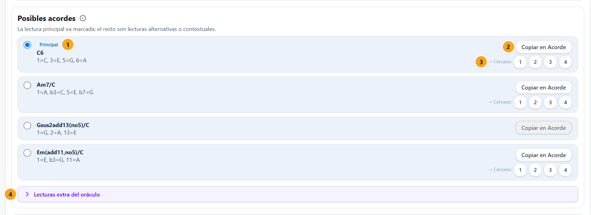

*Figura 22. Las notas C, A, E y G admiten varias lecturas. La principal es C6; la segunda, Am7/C.*

| Nº | Elemento | Qué hace |
| --- | --- | --- |
| 1 | **Principal** | Marca la lectura que la aplicación considera más probable. El botón redondo de cada lectura la convierte en la activa. |
| 2 | **Copiar en Acorde** | Pasa esa lectura al constructor y vuelve al modo Auto para seguir editándola. Está desactivado si la lectura no se puede construir. |
| 3 | **→ Cercano** 1–4 | Copia la lectura en el hueco correspondiente de Acordes cercanos. |
| 4 | **Lecturas extra del oráculo** | Despliega lecturas adicionales calculadas por otro método. Son solo informativas. |

Cada lectura muestra su nombre y, debajo, qué función tiene cada nota (*1=C, 3=E, 5=G, 6=A*). Si existen, un apartado plegable **Lecturas avanzadas / contextuales** reúne lecturas cuartales, fragmentos o lecturas que solo tienen sentido en un contexto concreto.

El ejemplo de la figura es un caso clásico: C6 y Am7 tienen exactamente las mismas notas. Con C en el bajo, la lectura natural es C6; si la armonía gira en torno a La menor, el mismo voicing funciona como Am7 en 1ª inversión (Am7/C). Ninguna de las dos es incorrecta: decide el contexto.

### Mantener lectura anterior y Referencia

- **Mantener lectura anterior** intenta conservar la lectura funcional previa cuando cambias pocas notas. Es útil al mover una voz para ver cómo evoluciona el mismo acorde. Si está desmarcada, la lectura activa es siempre la primera que propone el motor.
- **Referencia** te deja indicar el acorde sobre el que estás tocando (raíz, alteración y tipo). Las lecturas compatibles con ese acorde suben en la lista, sin eliminar ninguna. Además, el Modo estudio lo muestra como **Acorde de referencia**.

### Escuchar la selección

Los iconos de altavoz, reproducir y nota musical permiten oír lo que has marcado. El sonido al pulsar está apagado al abrir la aplicación y vuelve a estarlo al recargar la página. Debajo de las lecturas, **Pentagrama de la selección actual** escribe las notas marcadas en cuanto las pulsas, sin esperar a elegir una lectura.

## Comparar acordes cercanos

**Acordes cercanos** muestra hasta cuatro acordes a la vez en la misma zona del mástil, cada uno con su color. Es la herramienta para trabajar progresiones: verás qué notas se mantienen entre acordes, cuáles se mueven por semitono y cómo enlazarlos sin saltos de mano.

### La cabecera y los huecos

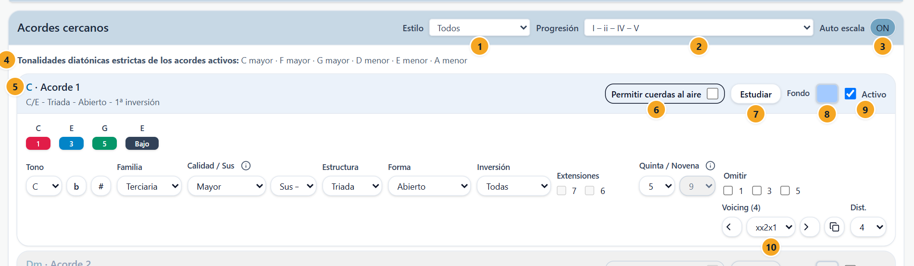

*Figura 23. Cabecera de Acordes cercanos con Auto escala activado y el primer hueco desplegado.*

| Nº | Control | Qué hace |
| --- | --- | --- |
| 1 | **Estilo** | Filtra las progresiones por género: Pop, Rock, Jazz, Blues, Soul / R&B, Funk, Flamenco / Andaluz, Modal… |
| 2 | **Progresión** | Progresión que se genera con **Auto escala**, por ejemplo *ii7 – V7 – Imaj7 · Jazz mayor*. |
| 3 | **Auto escala** | Con **ON**, los huecos se rellenan según la nota raíz, la escala y la armonización del contexto tonal. Con **OFF**, cada hueco se edita a mano. |
| 4 | Tonalidades diatónicas | Tonalidades mayores y menores en las que todos los acordes activos son diatónicos. |
| 5 | Título del hueco | Acorde del hueco y, debajo, su estructura, forma e inversión. |
| 6 | **Permitir cuerdas al aire** | Igual que en Acordes, pero solo para ese hueco. |
| 7 | **Estudiar** | Abre el Modo estudio de ese acorde. |
| 8 | **Fondo** | Color del hueco en el mástil compartido. |
| 9 | **Activo** | Incluye o excluye el hueco del mástil y de los cálculos. |
| 10 | **Voicing** | Digitación del hueco. La opción **(auto)** elige automáticamente la más cercana. |

### Auto escala, Estilo y Progresión

Con **Auto escala** activado, elige un **Estilo** para acotar la lista y una **Progresión**. Los cuatro huecos se rellenan con los acordes de esa progresión en la tonalidad del contexto tonal, y se actualizan si cambias la nota raíz o la escala. Con Do mayor e *I – ii – IV – V*, por ejemplo, los huecos son C, Dm, F y G.

Si desactivas **Auto escala**, los acordes se quedan como están y puedes editar cada hueco libremente. Cargar acordes desde Standards (capítulo 10) o desde el modo Manual desactiva Auto escala para respetar esos acordes.

### Editar los huecos

Cada hueco activo se despliega con los mismos controles que el constructor de Acordes (apartado 6.2): tono, familia, calidad, estructura, forma, inversión, extensiones, alteraciones y omisiones, además de su propio selector de voicing, el botón de copiar y **Dist.**

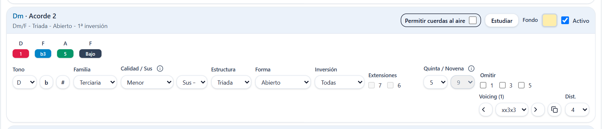

*Figura 24. El hueco 2, activo, con Dm. Cada hueco tiene sus propios controles y se edita de forma independiente.*

### El mástil compartido

**Mástil: acordes cercanos** dibuja los voicings de todos los huecos activos a la vez. Cada acorde usa el color de su hueco y cada círculo indica el grado de esa nota dentro de su acorde.

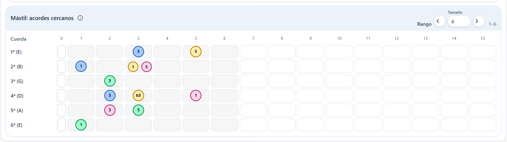

*Figura 25. I – ii – IV – V en Do mayor entre los trastes 1 y 6: C en azul, Dm en amarillo, F en verde y G en rosa.*

- Los voicings se buscan dentro del **Rango** indicado en la cabecera del mástil y se ordenan por cercanía al primer acorde activo. Mueve el rango con las flechas o cambia su **Tamaño** para probar otra zona.
- Cuando dos acordes comparten una nota en el mismo traste, se ven dos círculos juntos, como en Comparar.

### Analizador de tonalidad / progresión

Encima de los huecos, el panel plegable **Analizador de tonalidad / progresión** estima la tonalidad de una serie de acordes. Es útil cuando tienes el cifrado de una canción y no sabes en qué tonalidad está.

1. Despliega el panel.
2. Escribe los acordes separados por espacios, barras `|`, comas o saltos de línea. Admite acordes con bajo, como `A/E`.
3. Pulsa **Analizar** o Ctrl+Enter.

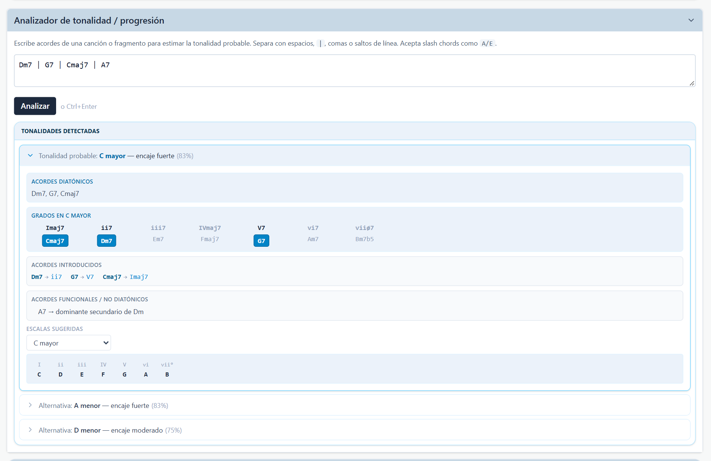

*Figura 26. Análisis de Dm7, G7, Cmaj7 y A7: tonalidad probable Do mayor, con A7 como dominante secundario de Dm.*

El resultado muestra la **Tonalidad probable** con su grado de encaje y las alternativas. Para cada una indica los **Acordes diatónicos**, los grados de la tonalidad con los acordes introducidos resaltados, la función de cada acorde introducido, los **Acordes funcionales / no diatónicos** (dominantes secundarios, intercambio modal) y las **Escalas sugeridas**.

### Ejemplo: un ii-V-I en Do mayor

1. En **Contexto tonal**, elige Do mayor.
2. En **Acordes cercanos**, con **Auto escala** activado, elige **Estilo** **Jazz** y **Progresión** *ii7 – V7 – Imaj7 · Jazz mayor*. Los huecos 1, 2 y 3 pasan a ser Dm7, G7 y Cmaj7.
3. Marca **Activo** en los huecos 2 y 3 (el 1 ya lo está) y deja sin marcar el 4.
4. Desplaza el **Rango** hasta encontrar una zona donde los tres voicings queden a uno o dos trastes entre sí.
5. Fíjate en la conducción de voces: la 7ª de Dm7 (C) baja a la 3ª de G7 (B), y la 7ª de G7 (F) baja a la 3ª de Cmaj7 (E).

## Trabajar con Standards

La sección **Standards** reúne los cifrados de más de 1400 temas de jazz, sin melodía. Para cada tema muestra su forma compás a compás y te deja enviar hasta cuatro de sus acordes a Acordes cercanos para estudiar los voicings.

### Buscar en el catálogo

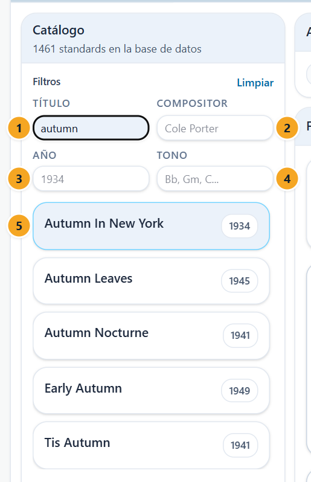

*Figura 27. Catálogo filtrado por la palabra «autumn» en el título.*

| Nº | Filtro | Qué hace |
| --- | --- | --- |
| 1 | **Título** | Busca por parte del título. |
| 2 | **Compositor** | Busca por autor. |
| 3 | **Año** | Busca por año de composición. |
| 4 | **Tono** | Busca por tonalidad, por ejemplo `Bb` o `Gm`. |
| 5 | Resultado | Pulsa un tema para abrir su ficha. |

Los filtros se combinan entre sí. **Limpiar** los borra todos.

### La ficha y la forma

La ficha muestra una breve descripción del tema, sus autores, el año y la tonalidad. Debajo, **Forma** presenta el cifrado organizado por secciones (A, B, C…, con primera y segunda vuelta cuando las hay) y numerado por compases.

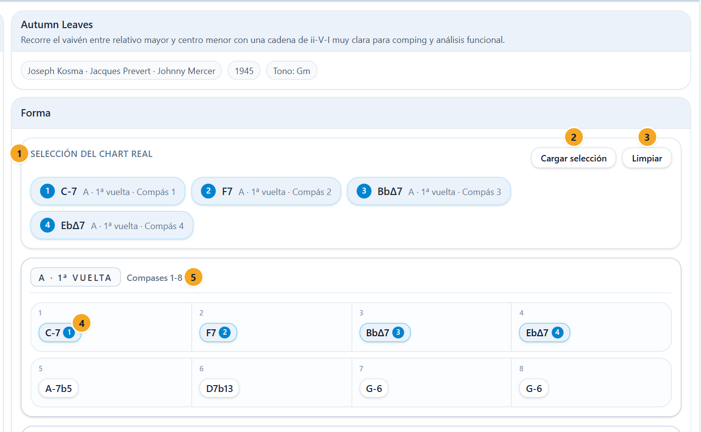

*Figura 28. Primeros compases de Autumn Leaves, con sus cuatro primeros cambios seleccionados.*

| Nº | Elemento | Qué hace |
| --- | --- | --- |
| 1 | **Selección del chart real** | Lista los cambios seleccionados, numerados, con su sección y compás. Cada uno se puede quitar desde ahí. |
| 2 | **Cargar selección** | Envía los cambios seleccionados a Acordes cercanos. |
| 3 | **Limpiar** | Vacía la selección. |
| 4 | Cambio seleccionado | Pulsa un acorde de la forma para añadirlo o quitarlo; el número indica su posición en la selección. |
| 5 | Sección | Nombre de la sección y compases que abarca. |

Los cifrados usan la notación habitual de los *real books*:

| Cifrado | Equivale a |
| --- | --- |
| C-7 | Cm7 |
| BbΔ7 | Bbmaj7 |
| A-7b5 | Am7(b5), también escrito Aø |
| Ebo7 | Ebdim7 |
| G-6 | Gm6 |
| D7b13 | D7 con 13 bemol |

### Enviar acordes a Acordes cercanos

1. Pulsa hasta cuatro acordes de la forma. Si intentas añadir un quinto, la aplicación te avisa del límite.
2. Pulsa **Cargar selección**. Aparece un aviso de confirmación y **Auto escala** se desactiva para respetar la armonía del tema.
3. Abre **Acordes cercanos**: los huecos contienen los acordes seleccionados.

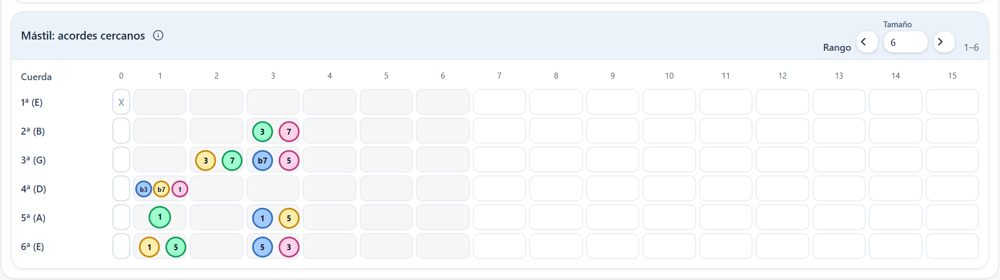

*Figura 29. Cm7, F7, Bbmaj7 y Ebmaj7, el ii-V-I-IV de Autumn Leaves, en el mástil de Acordes cercanos.*

Los cifrados que la aplicación todavía no sabe construir se conservan en la forma, pero no se cargan: el hueco correspondiente queda desactivado y el aviso explica el motivo.

## Configuración, presets y copia de seguridad

La sección **Configuración** reúne los ajustes que afectan a toda la aplicación.

### El panel de Configuración

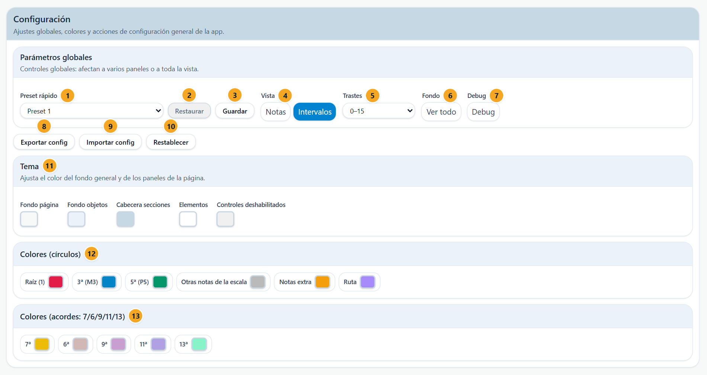

*Figura 30. Panel de Configuración en ordenador.*

| Nº | Control | Qué hace |
| --- | --- | --- |
| 1 | **Preset rápido** | Elige uno de los tres presets rápidos. |
| 2 | **Restaurar** | Carga la configuración guardada en el preset elegido. Está desactivado si el preset está vacío. |
| 3 | **Guardar** | Guarda la configuración actual en el preset elegido. |
| 4 | **Vista** | **Notas** e **Intervalos**: qué se escribe dentro de los círculos (apartado 3.2). |
| 5 | **Trastes** | Rango de trastes de los mástiles, de 0–12 a 0–24 (apartado 3.4). |
| 6 | **Fondo** | **Ver todo** muestra las notas que no pertenecen a la escala (apartado 3.3). |
| 7 | **Debug** | Muestra detalles técnicos del cálculo de rutas. |
| 8 | **Exportar config** | Descarga toda la configuración en un archivo JSON. |
| 9 | **Importar config** | Carga un archivo exportado antes. |
| 10 | **Restablecer** | Vuelve a los valores por defecto (los presets se conservan). |
| 11 | **Tema** | Colores del fondo de la página, de los paneles, de las cabeceras y de los controles. |
| 12 | **Colores (círculos)** | Colores de la raíz, la 3ª, la 5ª, el resto de notas, las notas extra y la ruta. |
| 13 | **Colores (acordes)** | Colores de las extensiones 7, 6, 9, 11 y 13 en los acordes. |

### Presets rápidos

Un preset guarda todo lo que la aplicación recuerda entre sesiones: contexto tonal, sección activa, acordes, huecos de Acordes cercanos, ruta, vista, tema y colores. Tienes tres.

1. Deja la aplicación como quieras recordarla.
2. Elige un preset en **Preset rápido** y pulsa **Guardar**. La aplicación te pide un nombre para reconocerlo después.
3. Para volver a ese estado más adelante, elige el preset y pulsa **Restaurar**.

Al pasar el ratón por **Restaurar** verás el nombre del preset y cuándo se guardó. Los presets se conservan al pulsar **Restablecer** y al actualizar la aplicación.

### Exportar e importar la configuración

**Exportar config** descarga un archivo con el nombre `mastil_interactivo_config_AAAAMMDD_HHMMSS.json`, con la fecha y la hora. Guárdalo como copia de seguridad o úsalo para llevar tu configuración a otro navegador o dispositivo con **Importar config**. Si el archivo procede de una versión anterior, la aplicación lo carga y corrige los valores que ya no existen.

### Tema y colores

Pulsa cualquier muestra de color para abrir el selector y elegir otro. Los cambios se aplican al momento.

**Restablecer** borra la configuración guardada, incluidos los colores, y recarga la página con los valores por defecto. Antes pide confirmación. Los presets rápidos no se borran.

## Móvil, ayuda e instalación

### Usar la aplicación en el móvil

En pantallas estrechas la aplicación cambia de distribución para poder usarse con una mano.

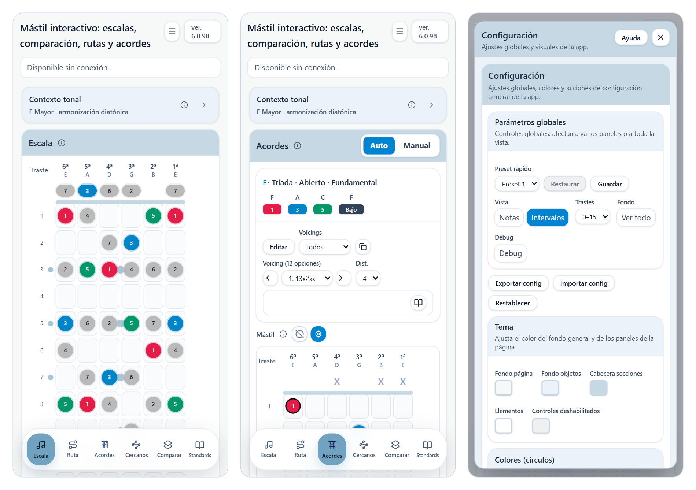

*Figura 31. En el móvil: sección Escala con el mástil en vertical, sección Acordes y menú de configuración abierto.*

- **Barra inferior.** Cambia de sección: Escala, Ruta, Acordes, Cercanos, Comparar y Standards. También puedes deslizar el dedo a izquierda o derecha para pasar a la sección contigua.
- **Mástil en vertical.** Las cuerdas pasan a ser columnas, de la 6ª a la izquierda a la 1ª a la derecha, y los trastes avanzan hacia abajo.
- **Contexto tonal plegado.** Muestra solo el resumen de la tonalidad; pulsa la flecha para desplegar sus controles.
- **Editar acorde.** En Acordes, el botón **Editar** abre los controles del constructor en una ventana.
- **Menú de tres rayas.** Abre la **Configuración**, con el botón **Ayuda** para abrir este manual.
- **Iconos de información.** Púlsalos para leer la explicación de cada control, ya que en el móvil no hay cursor.

El rango de trastes de Acordes no se aplica en el móvil: se muestran las posiciones de todo el mástil.

### La ayuda dentro de la aplicación

El interrogante de la cabecera (en el móvil, **Ayuda** dentro del menú) abre un resumen rápido de cada sección. Desde ahí, **Abrir el manual en PDF** muestra este documento.

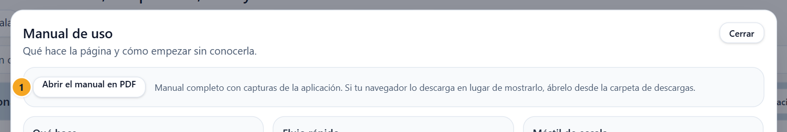

*Figura 32. Ventana de ayuda con el botón que abre el manual completo.*

Si tu navegador descarga el PDF en lugar de mostrarlo, ábrelo desde la carpeta de descargas.

### Instalar y usar sin conexión

Puedes instalar Mástil Escalas como una aplicación más:

- **Ordenador (Chrome, Edge):** usa el icono de instalar de la barra de direcciones o la opción **Instalar** del menú del navegador.
- **Android:** en el menú del navegador, elige **Instalar aplicación** o **Añadir a pantalla de inicio**.
- **iPhone o iPad:** en Safari, pulsa **Compartir** y después **Añadir a pantalla de inicio**.

Para usarla sin conexión:

1. Abre la aplicación con conexión a Internet la primera vez.
2. Espera al aviso **Disponible sin conexión**. A partir de ese momento funciona sin red, con todos los standards y este manual.

### Actualizaciones y configuración

Cuando hay una versión nueva aparece el aviso **Actualizar ahora**. Al pulsarlo se carga la versión nueva.

> **Atención.** Al cambiar de versión, la configuración actual se restablece a los valores por defecto. Los presets rápidos se conservan. Antes de actualizar, guarda tu configuración en un preset o expórtala.

## Problemas frecuentes y límites

- **Aparece «No he encontrado voicings para este acorde con los filtros actuales».** La combinación pedida no tiene ninguna digitación que cumpla todos los filtros. Prueba, por este orden: subir **Dist.**, elegir **Todas** en **Inversión**, cambiar de **Forma**, activar **Permitir cuerdas al aire**, pulsar **Todo el mástil** o quitar alguna extensión. El ejemplo del apartado 6.5 muestra un caso real.

- **Una opción está desactivada.** No es compatible con el resto de la configuración: la novena no existe en una tríada, las formas drop exigen cuatriadas de cuatro notas y la 3ª inversión solo existe si hay séptima. El icono de información del control explica el motivo.

- **La ruta pone más notas en una cuerda de las indicadas.** **Máx. notas** es orientativo: la ruta lo supera cuando respetarlo empeoraría la digitación.

- **No puedo pulsar un traste en Ruta.** Solo se pueden elegir notas de la escala activa. Cambia la escala o elige otra posición.

- **El modo Manual no da el nombre que esperaba.** Revisa las demás lecturas de **Posibles acordes**: un mismo grupo de notas puede tener varios nombres válidos (apartado 8.3). Si sabes sobre qué acorde estás tocando, indícalo en **Referencia**.

- **Exportar PDF no hace nada.** El navegador está bloqueando la ventana emergente. Permite las ventanas emergentes para la aplicación y vuelve a pulsarlo.

- **No se oye nada en el modo Manual.** El altavoz está tachado: púlsalo para activar el sonido. Vuelve a apagarse al recargar la página.

- **En el móvil no veo el rango de trastes de Acordes.** Es intencionado: en el móvil se muestran las posiciones de todo el mástil.

- **He perdido mi configuración al actualizar.** Es el comportamiento esperado al cambiar de versión. Restaura un preset rápido o importa la configuración exportada.

- **Un acorde de un standard aparece desactivado.** La aplicación aún no sabe construir ese cifrado. Se conserva en la forma, pero no se carga en Acordes cercanos.

## Glosario

| Término | Significado |
| --- | --- |
| Raíz | Nota que da nombre a la escala o al acorde. |
| Grado | Posición de una nota dentro de la escala (1, 2, 3…), con alteración si difiere de la escala mayor (b3, #4…). |
| Tríada | Acorde de tres notas: raíz, tercera y quinta. |
| Cuatriada | Tríada con una cuarta nota, normalmente la séptima o la sexta. |
| Extensión o tensión | Nota añadida por encima de la séptima: 9, 11 o 13, con sus alteraciones. |
| Voicing | Forma concreta de repartir las notas de un acorde en el instrumento. |
| Digitación | Trastes que se pisan en cada cuerda para tocar un voicing, por ejemplo `x7958x`. |
| Inversión | Indica qué nota del acorde está en el bajo: fundamental, 1ª (3ª en el bajo), 2ª (5ª) o 3ª (7ª). |
| Posición cerrada | Voicing con las notas lo más juntas posible. |
| Drop 2, Drop 3, Drop 2+4 | Voicings que se obtienen bajando una octava la 2ª, la 3ª o la 2ª y la 4ª voz, contando desde arriba, de un acorde cerrado. |
| Set | Grupo de cuerdas en que se coloca una forma drop. |
| Notas guía | La 3ª y la 7ª de un acorde, las que definen su calidad. |
| Acorde cuartal | Acorde construido por cuartas en lugar de terceras. |
| Nota característica | Nota que distingue un modo de los demás, como el #4 de Lidia. |
| Dominante secundario | Acorde dominante que resuelve en un grado de la tonalidad distinto del I, como A7 hacia Dm en Do mayor. |
| Backdoor | Dominante construido sobre el bVII que resuelve en el I, como Bb7 hacia C. |
| Armonización diatónica | Acordes formados solo con notas de la escala. |
| Acorde con bajo | Acorde con una nota distinta de la raíz en el bajo, escrito con barra: Am7/C. |
